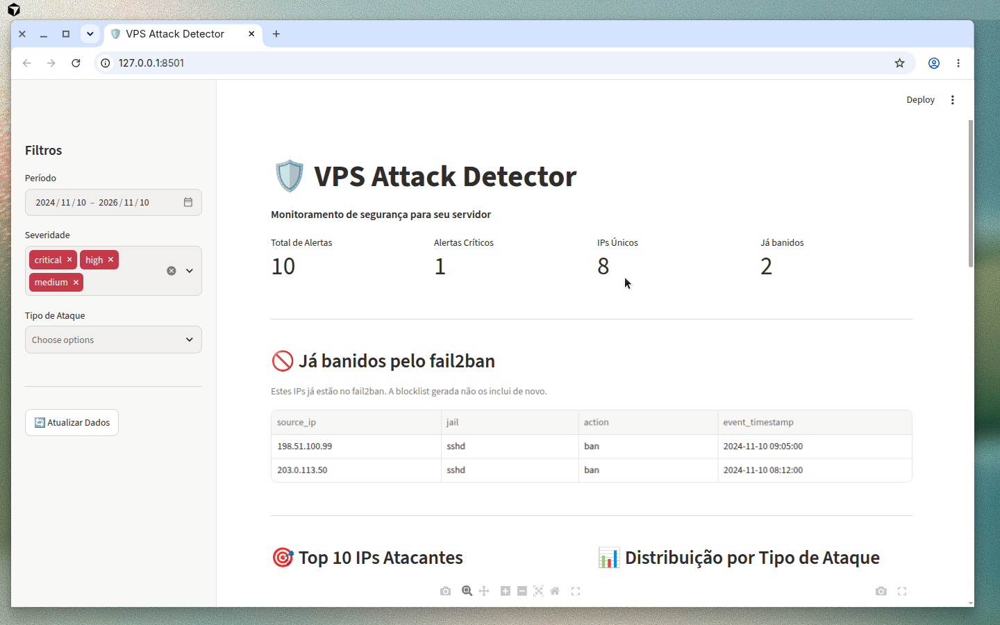

# 🛡️ VPS Attack Detector

Sistema de detecção de ataques para servidores Linux, construído como um pipeline de engenharia de dados com Apache Airflow e Apache Spark.

<p>
  
  
  
  
  
  
</p>

> **Rodando em produção** no meu próprio VPS. Em 4 dias (8 a 11/11/2026), o pipeline processou
> **~6.000 eventos SSH** e gerou **54 alertas** (41 de *credential stuffing* e 13 de *SSH brute force*)
> vindos de **52 IPs diferentes**.

<p align="center">
  
  <br><sub>Dashboard Streamlit com dados de exemplo (IPs de documentação, RFC 5737).</sub>
</p>

| 🔥 Ingestão | 🧹 Bronze → Silver → Gold | 🚨 Detecção | 📊 Saída |
|---|---|---|---|
| auth.log, fail2ban, nginx e Docker, a cada hora | Spark com camadas medalhão e GeoIP | brute force, credential stuffing e IPs de threat feeds | dashboard Streamlit, relatórios diários e blocklist |

## 📋 Índice

- [O que é](#o-que-é)
- [Arquitetura](#arquitetura)
- [Pré-requisitos](#pré-requisitos)
- [Quick Start](#quick-start)
- [Configuração](#configuração)
- [Uso em Produção](#uso-em-produção)
- [Segurança](#segurança)
- [Desenvolvimento](#desenvolvimento)
- [Troubleshooting](#troubleshooting)

## O que é

O VPS Attack Detector ingere logs do seu servidor (SSH, nginx, Docker), processa com Spark em uma arquitetura Bronze/Silver/Gold, detecta padrões de ataque conhecidos e apresenta os resultados em um dashboard interativo.

### Tipos de Ataque Detectados

| Tipo | Descrição | Severidade |
|------|-----------|------------|
| **SSH Brute Force** | Múltiplas tentativas de login falhas do mesmo IP | Alta |
| **Credential Stuffing** | Tentativas com usuários inválidos (admin, test, etc) | Média |
| **Success After Failure** | Login bem-sucedido após muitas falhas | **Crítica** |
| **Path Scanning** | Probing de paths vulneráveis (/wp-admin, /.env, etc) | Média |
| **Scanner Detection** | User-agents de ferramentas de scan (sqlmap, nikto) | Média |
| **Rate Spike** | Picos anormais de requisições | Média |

### Mapeamento MITRE ATT&CK

Cada tipo de detecção corresponde a técnicas conhecidas do framework [MITRE ATT&CK](https://attack.mitre.org/):

| Detecção | Técnica MITRE ATT&CK | ID | Descrição |
|----------|----------------------|----|-----------|
| **SSH Brute Force** | Brute Force | [T1110.001](https://attack.mitre.org/techniques/T1110/001/) | Password Guessing - tentativas repetidas de adivinhar credenciais |
| **Credential Stuffing** | Brute Force | [T1110.004](https://attack.mitre.org/techniques/T1110/004/) | Credential Stuffing - uso de listas de credenciais vazadas |
| **Success After Failure** | Valid Accounts | [T1078](https://attack.mitre.org/techniques/T1078/) | Uso de contas válidas após comprometimento de credenciais |
| **Path Scanning** | Active Scanning | [T1595.002](https://attack.mitre.org/techniques/T1595/002/) | Vulnerability Scanning - probing de paths vulneráveis |
| **Scanner Detection** | Active Scanning | [T1595.001](https://attack.mitre.org/techniques/T1595/001/) | Scanning IP Blocks - uso de ferramentas automatizadas |
| **Rate Spike** | Network Denial of Service | [T1498](https://attack.mitre.org/techniques/T1498/) | Possível DDoS ou scraping agressivo |

> **Nota:** O mapeamento MITRE ATT&CK ajuda a contextualizar os alertas dentro de um framework de segurança reconhecido, facilitando a priorização e resposta a incidentes.

## Arquitetura

```mermaid
graph TB
    subgraph Fontes
        A[auth.log] 
        B[nginx access.log]
        C[nginx error.log]
        D[Docker logs]
    end

    subgraph "Airflow DAGs"
        E[ingest_and_detect<br/>@hourly]
        F[refresh_threat_feeds<br/>@daily]
        G[daily_report<br/>@daily]
    end

    subgraph "Spark Jobs"
        H[Bronze Ingest]
        I[Silver Transform]
        J[Gold Detect]
    end

    subgraph "Data Lake"
        K[(Bronze<br/>Raw Logs)]
        L[(Silver<br/>Parsed + GeoIP)]
        M[(Gold<br/>Alerts + Stats)]
    end

    subgraph "Outputs"
        N[📊 Dashboard<br/>Streamlit]
        O[📄 Relatórios]
        P[📋 Blocklist]
    end

    A & B & C & D --> E
    E --> H --> K --> I --> L --> J --> M
    M --> N & O & P
    F --> M
    G --> O
```

### Estrutura de Diretórios

```
vps-attack-detector/
├── airflow/dags/           # DAGs do Airflow
├── spark/jobs/             # Jobs PySpark
│   └── utils/              # Parsers, detectores, GeoIP
├── dashboard/              # App Streamlit
├── config/                 # Configuração de detecção
├── data/
│   ├── sample_logs/        # Logs sintéticos para demo
│   ├── bronze/             # Dados brutos (Parquet)
│   ├── silver/             # Dados parseados (Parquet)
│   └── gold/               # Alertas e agregações (Parquet)
├── tests/                  # Testes pytest
├── docs/                   # Especificação e ADRs
└── scripts/                # Scripts auxiliares
```

## Pré-requisitos

- Docker e Docker Compose
- 4GB+ RAM disponível (para rodar junto com outros serviços)
- Portas disponíveis: 8085 (Airflow), 8501 (Dashboard), 8082 (Spark UI)

## Quick Start

### 1. Clone e configure

```bash
git clone <repo-url>
cd vps-attack-detector

# Copie e edite o arquivo de configuração
cp .env.example .env
# Edite .env conforme necessário (as configurações padrão funcionam para demo)
```

### 2. Inicie os serviços

```bash
# Construir e iniciar
make up

# Ou manualmente:
docker compose up -d
```

### 3. Execute o demo

```bash
make demo
```

Isso irá:
1. Iniciar todos os serviços
2. Executar o pipeline com os logs de exemplo
3. Gerar alertas no dashboard

### 4. Acesse as interfaces

- **Airflow:** http://localhost:8085 (admin/admin)
- **Dashboard:** http://localhost:8501
- **Spark UI:** http://localhost:8082

## Configuração

### Variáveis de Ambiente

Todas as configurações são feitas via variáveis de ambiente no arquivo `.env`:

```bash
# Airflow
AIRFLOW_PORT=8085
AIRFLOW_ADMIN_USER=admin
AIRFLOW_ADMIN_PASSWORD=sua_senha_segura

# Spark (ajuste conforme RAM disponível)
SPARK_WORKER_MEMORY=2g
SPARK_DRIVER_MEMORY=1g

# Dashboard
DASHBOARD_PORT=8501

# Logs (em produção, aponte para seus logs reais)
LOCAL_LOG_PATH=./data/sample_logs

# GeoIP (opcional - baixe de db-ip.com ou maxmind.com)
GEOIP_DB_PATH=./data/geoip/dbip-city-lite.mmdb
```

### Thresholds de Detecção

Edite `config/detection_rules.yaml` para ajustar os limiares:

```yaml
ssh_brute_force:
  threshold: 5          # Falhas para gerar alerta
  window_minutes: 10    # Janela de tempo

path_scanning:
  threshold: 10         # 404s suspeitos
  window_minutes: 5
```

## Uso em Produção

### Apontando para Logs Reais

1. **Opção A - Montagem local:**
   ```bash
   # No .env
   LOCAL_LOG_PATH=/var/log
   ```

2. **Opção B - Sync remoto:**
   ```bash
   # No .env
   REMOTE_HOST=seu-vps.exemplo.com
   REMOTE_USER=deploy
   REMOTE_SSH_PORT=22
   REMOTE_LOG_PATHS=/var/log/auth.log,/var/log/nginx/access.log
   SSH_KEY_FILE=/caminho/para/chave_ssh
   ```

### Configuração de Memória para VPS 8GB

Se o VPS roda outros serviços, use configurações conservadoras:

```bash
SPARK_WORKER_MEMORY=1500m
SPARK_DRIVER_MEMORY=1g
SPARK_CONTAINER_MEMORY=2000M
```

### GeoIP (Opcional)

Para enriquecer IPs com país/cidade:

1. Baixe o banco gratuito de https://db-ip.com/db/download/ip-to-city-lite
2. Extraia para `data/geoip/dbip-city-lite.mmdb`
3. Configure no `.env`:
   ```bash
   GEOIP_DB_PATH=./data/geoip/dbip-city-lite.mmdb
   ```

## Segurança

### ⚠️ Importante

1. **Nunca exponha as portas publicamente!** Airflow e Dashboard devem ser acessados apenas via SSH tunnel:
   ```bash
   # Do seu computador local:
   ssh -L 8085:localhost:8085 -L 8501:localhost:8501 usuario@seu-vps
   ```

2. **Altere as senhas padrão** no arquivo `.env`

3. **Acesso read-only aos logs:** O sistema apenas lê logs, nunca modifica arquivos do sistema

4. **Bloqueios são manuais:** O sistema detecta e sugere, mas nunca aplica bloqueios automaticamente (veja ADR-005)

### Gerando Blocklist

Para gerar uma lista de IPs para revisão manual:

```bash
make blocklist

# Ou diretamente:
python scripts/generate_blocklist.py --min-severity high
```

A lista gerada inclui comentários explicando cada IP. **Revise antes de aplicar!**

## Desenvolvimento

### Executando Testes

```bash
# Todos os testes
make test

# Com cobertura
make test-cov

# Desenvolvimento local (sem Docker)
make dev-install
make dev-test
```

### Estrutura de Testes

- `tests/test_parsers.py` - Testes dos parsers de log
- `tests/test_detectors.py` - Testes das regras de detecção
- `tests/test_geoip.py` - Testes do enriquecimento GeoIP

### Comandos Úteis

```bash
make up          # Inicia serviços
make down        # Para serviços
make logs        # Mostra logs
make clean       # Remove dados e containers
make shell-airflow  # Shell no container Airflow
```

## Troubleshooting

### Airflow não inicia

```bash
# Verifique os logs
docker compose logs airflow-init airflow-webserver

# Reinicie do zero
make clean && make up
```

### DAG com erro de parse

```bash
# Verifique sintaxe
docker compose exec airflow-scheduler python -c "import airflow.dags.ingest_and_detect"
```

### Dashboard sem dados

1. Verifique se o DAG `ingest_and_detect` foi executado
2. Verifique se há dados em `data/gold/alerts/`
3. Confira os logs: `docker compose logs dashboard`

### Memória insuficiente

Reduza os limites no `.env`:
```bash
SPARK_WORKER_MEMORY=1g
SPARK_CONTAINER_MEMORY=1500M
```

### Logs não encontrados

Verifique as permissões do diretório de logs e o caminho em `LOCAL_LOG_PATH`.

## Documentação Adicional

- [GLOSSARY.md](GLOSSARY.md) - Vocabulário do projeto
- [docs/SPEC.md](docs/SPEC.md) - Especificação completa
- [docs/adr/](docs/adr/) - Decisões arquiteturais
- [CODING_STANDARDS.md](CODING_STANDARDS.md) - Padrões de código

## Licença

MIT

---

*Desenvolvido para proteger servidores Linux de ataques comuns.*
